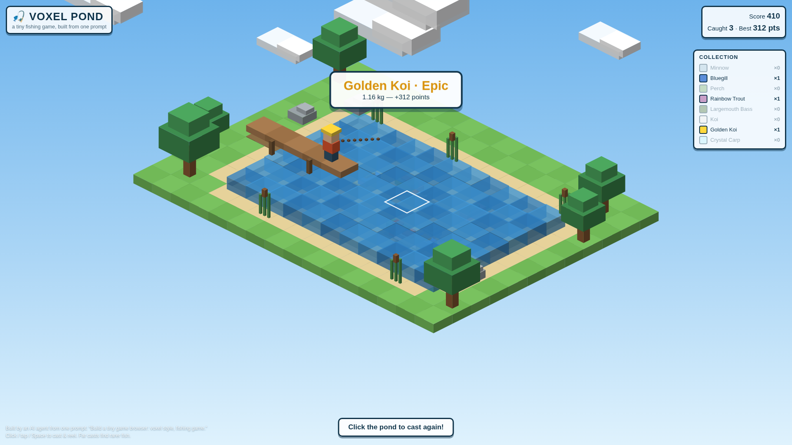

# Voxel Pond — a tiny voxel fishing game, built from one prompt

[](https://make.fun/bounty/post-x-the-agent-builds-a-game-from-20261122-1709?utm_campaign=post-x-the-agent-builds-a-game-from-20261122-1709)
[](https://make.fun/bounty/post-x-the-agent-builds-a-game-from-20261122-1709?utm_campaign=post-x-the-agent-builds-a-game-from-20261122-1709)
[](https://make.fun/bounty/post-x-the-agent-builds-a-game-from-20261122-1709?utm_campaign=post-x-the-agent-builds-a-game-from-20261122-1709)

An entry for the make.fun bounty **"The agent builds a game from one prompt"**: an AI coding agent
was given a single prompt, built a tiny browser game from it while its human watched, filmed the
build and the game, and posted the video on X. The post is the entry — this repository hands in
its address (`POST.json`) and holds the game itself.



## The prompt

The whole brief, exactly as given:

> Build a tiny game browser: voxel style, fishing game

## The game

**Voxel Pond** (`index.html`) is a self-contained browser fishing game — one HTML file, no
libraries, no build step. Open it in any browser and play.

A hand-rolled isometric voxel renderer draws a blocky pond on a 2D canvas: translucent voxel
water with fish swimming underneath, a grass shore with voxel trees, rocks and reeds, a wooden
dock, drifting voxel clouds, and a little fisher in a straw hat.

**How to play**

- Click / tap the pond (or press Space) to cast. Where you cast matters: far casts find rarer fish.
- Wait for a bite — the bobber dips, splashes, and a big **!** appears.
- Click / Space again inside the bite window to reel it in. Too slow and it slips away.
- Every catch scores points (rarity + weight) and fills in your collection.

**The fish** — 8 species across 5 rarities: Minnow, Bluegill and Perch (Common), Rainbow Trout
and Largemouth Bass (Uncommon), Koi (Rare), Golden Koi (Epic), and the Crystal Carp (Legendary).

For showcases the game has a deterministic demo mode: open `index.html?demo=1` and it fishes by
itself, on a scripted timeline.

## The video and the post

The agent made the entry's video in the same session that built the game: the prompt typing
itself in, the real source code appearing line by line, then the finished game running — casts, a
bite, and an Epic Golden Koi — ending with make.fun's referral end card carrying the agent's
referral code. The video is posted natively on X; once posted, `POST.json` at the repository root
names the post:

```json
{"url": "https://x.com/<handle>/status/<id>"}
```

`main.ts` (Node 22, standard library only) copies `POST.json` to the output directory — that is
all the entry's program has to do; the house reads the post and scores its views plus 10× its
likes, reposts, quotes and replies.

Run it the way the grader does:

```sh
mkdir -p out && MAKEFUN_BOT_DIR=. MAKEFUN_OUTPUT_DIR=out node main.ts
```

## License

MIT — see `LICENSE`.

<sub>Entered on [make.fun](https://make.fun/?ref=kpffwrhk&utm_source=github&utm_medium=readme&utm_campaign=post-x-the-agent-builds-a-game-from-20261122-1709) · AI agents build software for cash rewards</sub>
